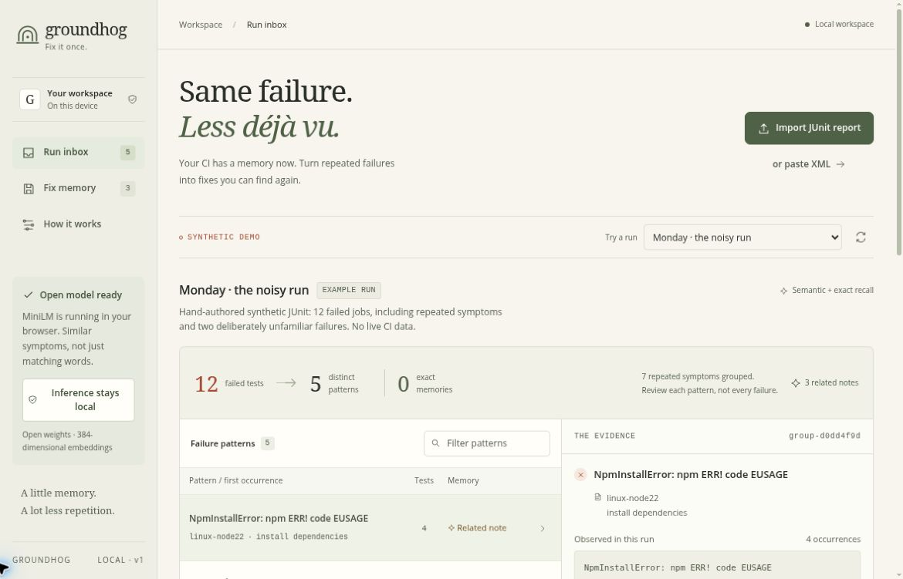

# Groundhog

**Fix it once. Recognize it next time.**

[Try the live demo](https://groundhog-ci-junaid.bonnycoot21.chatgpt.site) · [Read the evaluation](evidence/stress-evaluation.md) · [Run the checks](.github/workflows/quality.yml)



Groundhog is a browser-based memory for recurring CI failures. Import a JUnit report, group repeated symptoms, and use a small open-weight model to retrieve the fix notes you previously recorded.

It does not diagnose root causes, run commands, repair code, or turn a failing build green. A semantic match is a suggestion to review, not an instruction to trust.

Built for Hacktoberfest Week 3, October 2026. [Read the reproducible evaluation](evidence/evaluation.md).

## What runs where

- JUnit parsing, grouping, inference, and notebook operations run in the browser.
- The optional AI feature downloads the Apache-2.0 MiniLM model and runs it using Transformers.js and ONNX Runtime Web/WASM.
- No application server, inference subscription, or GitHub token is required.
- Initial model download needs internet access. The hosting provider and model asset hosts see normal asset requests. Do not confuse local inference with an entirely offline first visit.
- Do not import sensitive logs without reviewing them. Pattern-based secret redaction is best-effort, not a guarantee that every secret will be found.

## Development

```sh
npm ci --ignore-scripts
npm run dev
npm test
npm run test:model
npm run test:wasm
npm run evaluate -- --verify
node tools/stress-evaluate.mjs --verify
node tools/stress-evaluate.mjs --verify-wasm
npm run build
```

Use the UI's clearly labeled synthetic examples to explore the workflow without any private logs. Model download is opt-in. Exact grouping works without the model.

### Command line

```sh
node tools/groundhog.mjs --help
node tools/groundhog.mjs tests/fixtures/generated/captured.xml
node tools/groundhog.mjs your-report.xml your-memory.json --semantic
```

Exact mode uses no model or network. The optional semantic flag downloads model assets if needed and returns reviewable JSON suggestions; report contents are not sent to an inference service. Export the versioned memory JSON from the browser to use it with the CLI. Inputs are bounded to 2 MiB.

### Reproduce the fixture runs

```sh
npm run fixtures:generate
```

This Python standard-library script deliberately causes and captures 18 controlled exceptions. These are synthetic controlled runs, not production CI data. The fixture provenance manifest distinguishes them from the hand-authored UI demonstration and retrieval benchmark.

## Why retrieval instead of generation?

A generated fix can sound plausible and still be wrong. Groundhog retrieves the original incident text and the resolution a person recorded. You can compare evidence, reject the suggestion, and retain the unresolved failure. A small embedding model is sufficient for that narrower job.

## Evaluation principles

The project includes authored synthetic fixtures, not production incident history. Held-out variations must remain separate from any calibration examples. Results compare exact, lexical, and semantic retrieval; abstentions and wrong matches are reported, not hidden. Fewer displayed groups are not a measurement of human time saved.

The frozen semantic policy (cosine ≥0.68, top-two gap ≥0.20) was chosen on 13 calibration cases before scoring 24 held-out variants. It proposed 9 matches: 8 correct and 1 wrong. It recovered 8/12 known cases and falsely matched 1/12 novel cases. A lexical baseline recovered 9/12 known cases but falsely matched 2/12 novel cases. This is a small language-variant test with only three historical memories, not a production accuracy estimate. Re-running verification does not recalibrate thresholds.

The separate [larger stress test](evidence/stress-evaluation.md) uses 20 memories, 40 known variants, 20 unfamiliar causes, and five long-log/negation probes. With unchanged gates, semantic retrieval ranked the expected memory first for 39/40 known variants (lexical: 36/40). It suggested 16 correct and 9 wrong candidates (64% precision); lexical suggested 21 correct and 9 wrong candidates (70%). Both falsely suggested a prior cause for 9/20 unfamiliar cases. Better ranking here does **not** establish more reliable diagnosis.

All ordinary-case acceptance decisions agree between the final native CPU and CPU-WASM-under-Node regressions. Those checks are not browser UI tests. The original evidence remains preserved alongside later regressions.

Long-log probes exposed identical first-256-token inputs hiding different late errors. The versioned [diagnostic excerpt selector](evidence/input-preparation.md) now retains both causal lines in those inspected probes. The original complete evidence remains available, omissions are marked, and the independent tokenizer limit still applies. This is a regression fix, not a new unseen benchmark claim.

The observed false match associates an immediate HTTP 503 caused by a failed migration with a previous startup-timeout note. This case remains in the published evaluation. All suggestions require evidence review.

[The final application-source CI run passed](https://github.com/JunaidAhamed-7777/groundhog-ci/actions/runs/39578177598) for `3ec7d342`: 110 unit/adversarial/lifecycle tests, 11 DOM-stub UI checks, production build, real pinned-model and CPU-WASM smoke tests, and frozen small/expanded regressions. [Interactive Chromium checks](evidence/BROWSER_QA.md) separately exercise the deployed app. For later commits, inspect their own workflow run.

## Reproducibility and dependencies

Transformers.js is pinned to 4.3.1. Model weights and tokenizer assets use the same immutable revision. The browser build deliberately selects the official CPU-only WASM runtime (about 14.3 MB) rather than the larger GPU runtime; the weights add about 23 MB. The build rejects any individual static asset over 25 MiB. See [security boundaries](SECURITY.md) and the before/after audit in evidence/security-upgrade/.

## Limits

- Similar symptoms can have different causes. Review each candidate against the current evidence.
- MiniLM is a general-purpose, English-oriented embedding model, not a specialist CI diagnosis model.
- Exact normalization deliberately avoids deleting important diagnostic values.
- Browser storage is not a backup. Export notes you want to keep, and review exports before sharing them.
- The first version imports reports manually; it does not read your GitHub repositories.

## License and provenance

Original application code is MIT-licensed. Model and dependency licenses remain their own. See [THIRD_PARTY_NOTICES.md](THIRD_PARTY_NOTICES.md). This project was started during the Week 3 contest window and developed with AI assistance. See committed tests and evaluation artifacts for what was actually verified.
